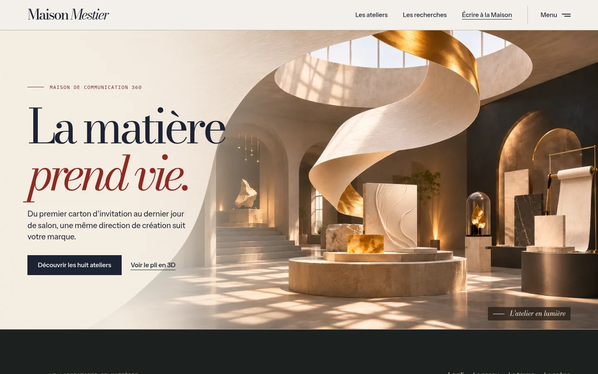

# Maison Mestier · L’atelier en lumière

Une maison de communication 360 dans le Sud de la France. Depuis l’accueil, on peut choisir parmi huit ateliers ou manipuler la feuille de papier qui devient un portique de stand.

**[Visiter l’expérience sur GitHub Pages](https://iizaanaamii-dev.github.io/Maison-mestier/atelier-en-lumiere/)**

[](https://iizaanaamii-dev.github.io/Maison-mestier/atelier-en-lumiere/)

## Parcourir le site

- **[Laboratoire de matières](https://iizaanaamii-dev.github.io/Maison-mestier/atelier-en-lumiere/#matiere)**. Faites avancer le pli, pressez le sceau, révélez la trame et ouvrez le rideau. Chaque étude propose une réglette réversible, deux angles de vue et un tirage fixe.
- **[Stands & Salons](https://iizaanaamii-dev.github.io/Maison-mestier/atelier-en-lumiere/ateliers/stands-salons/)** ouvre les huit fiches métier. Chacune possède son adresse, un accès aux ateliers liés et une invitation à écrire au sujet du projet.
- **[Recherches de la Maison](https://iizaanaamii-dev.github.io/Maison-mestier/atelier-en-lumiere/#recherches)** rassemble trois études internes avec leurs images et leur geste en 3D. La provenance des visuels et les références Awwwards figurent dans la [direction artistique](docs/direction-artistique.md).

## Développer

Avec Node.js 22 ou ultérieur, depuis la racine du dépôt :

```sh
npm ci
npm run dev
```

Le serveur de développement s’ouvre sur <http://localhost:3000>. Les pages Next.js sont rendues en HTML. Three.js et React Three Fiber se chargent lorsque le laboratoire entre à l’écran. GSAP pilote les gestes. La préférence de mouvement réduit, le mode économie de données et l’absence de WebGL donnent accès aux tirages fixes.

- Les textes des huit métiers sont dans [lib/ateliers.json](lib/ateliers.json). Les études, leurs légendes et leurs liens figurent dans [lib/maison.ts](lib/maison.ts).
- Les modèles, les textures procédurales et l’éclairage sont dans [components/scene](components/scene). Les [polices locales](app/fonts) et leurs [licences](public/licences) accompagnent la version publiée.
- Le formulaire prépare un brouillon que le visiteur peut copier ou ouvrir dans sa messagerie. Après confirmation de l’adresse de réception, définir `NEXT_PUBLIC_CONTACT_EMAIL` à la compilation pour renseigner le destinataire. Le dessin du cachet reste une étude de monogramme.

## Vérifier et exporter

```sh
npm run typecheck
NEXT_PUBLIC_BASE_PATH=/Maison-mestier/atelier-en-lumiere npm run build
```

Le répertoire `out/` contient le site statique. Pour servir le site à la racine d’un domaine, construire avec `npm run build` sans préfixe. Pour GitHub Pages, l’export est placé dans `atelier-en-lumiere/` sur la branche `gh-pages`. Le fichier `version.json` de l’aperçu identifie le commit source. Les résultats des parcours navigateur et les conditions de mesure figurent dans la [recette](docs/recette.md).
