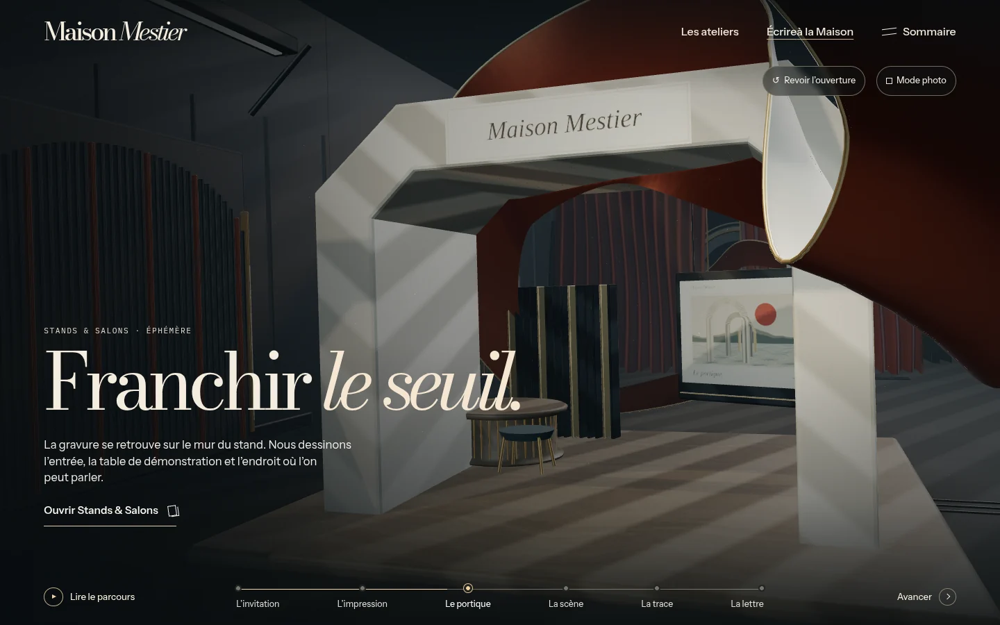

# Maison Mestier · Le plan-séquence

**[Ouvrir l’invitation](https://iizaanaamii-dev.github.io/Maison-mestier/atelier-en-lumiere/#cachet)** · [Voir la traversée sur téléphone](https://iizaanaamii-dev.github.io/Maison-mestier/atelier-en-lumiere/traversee/visite-mobile.mp4)

La première page est une lettre scellée. Un toucher sur la cire soulève le rabat. La caméra passe entre les feuilles, rejoint la presse, franchit le portique d’un stand et traverse le rideau d’une scène. Le même filet de laiton la guide dans une trame numérique jusqu’à la table de correspondance.

[](https://iizaanaamii-dev.github.io/Maison-mestier/atelier-en-lumiere/#portique)

## Parcourir la Maison

- Le défilement, les six repères et les commandes du clavier avancent ou remontent le même trajet. « Lire le parcours » lance une traversée continue qui ralentit aux haltes. Une intervention du visiteur rend la main. [Entrer sous le portique](https://iizaanaamii-dev.github.io/Maison-mestier/atelier-en-lumiere/#portique)
- Le carnet ouvre les huit ateliers, les trois études et la méthode par-dessus la scène. Fermer le dossier restitue la position de caméra. Les onze fiches et l’établi ont aussi leur propre page. [Ouvrir Stands & Salons](https://iizaanaamii-dev.github.io/Maison-mestier/atelier-en-lumiere/?carnet=atelier%3Astands-salons#portique) · [Établi des matières](https://iizaanaamii-dev.github.io/Maison-mestier/atelier-en-lumiere/laboratoire/)
- « Écrire à la Maison » prépare un brouillon à copier ou à ouvrir dans la messagerie. Il se conserve pendant la visite dans l’onglet. Le destinataire et le monogramme définitif attendent la validation de la Maison.

## Modèles, lumière et direction artistique

Les deux fichiers Blender natifs contiennent le cachet en noyer et laiton et la presse à volant. L’estampe du carton réapparaît sur le stand. Les veines du travertin, le brossage du métal, le grain du papier et du noyer et le poil du velours proviennent de relevés sous CC0. Un panorama de studio HDR éclaire les surfaces. [Fichiers Blender modifiables](art/blender) · [Storyboard, Awwwards, Adobe Substance et matières](docs/plan-sequence.md)

## Développer

Avec Node.js 22 ou ultérieur, installer les dépendances puis ouvrir le serveur local.

```sh
npm ci
npm run dev
```

Le serveur s’ouvre sur <http://localhost:3000>. La visite emploie une caméra Three.js, des annotations HTML et une partition GSAP. La préférence de mouvement réduit, l’économie de données, le mode photo ou la perte de WebGL donnent accès aux images calculées depuis les mêmes positions de caméra. Les six chapitres et les liens restent lisibles avec JavaScript désactivé.

```sh
npm run typecheck
NEXT_PUBLIC_BASE_PATH=/Maison-mestier/atelier-en-lumiere npm run build
```

Le build statique se trouve dans `out/`. La branche de prévisualisation sert le dossier `atelier-en-lumiere/`. [Révision publiée](https://iizaanaamii-dev.github.io/Maison-mestier/atelier-en-lumiere/version.json) · [Recette et captures](docs/recette-plan-sequence.md)

Les textes des huit métiers sont dans [le répertoire éditorial](lib/ateliers.json). Les six légendes, le trajet de la caméra et les sources reproductibles se trouvent dans [la traversée](components/traversee) et [l’atelier de production](art). Définir `NEXT_PUBLIC_CONTACT_EMAIL` au build quand l’adresse de réception est validée.
